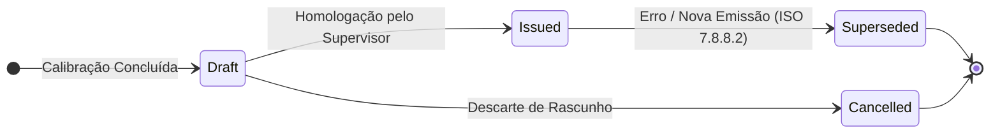

# TracLabs — Plataforma de Gestão Metrológica e Emissão de Laudos ISO/IEC 17025

[](https://dotnet.microsoft.com/download/dotnet/10.0)
[](https://dotnet.microsoft.com/apps/aspnet/web-apps/blazor)
[](https://www.postgresql.org/)
[](https://www.questpdf.com/)
[](https://xunit.net/)
[](https://www.inmetro.gov.br/)

O **TracLabs** é uma plataforma desenvolvida para **laboratórios de metrologia e calibração**, projetada para substituir controles manuais em planilhas eletrônicas por uma arquitetura distribuída, segura e automatizada, em estrita conformidade com os requisitos da norma **ABNT NBR ISO/IEC 17025:2017** e das diretrizes do **INMETRO (DOC-CGCRE-027)**.

O sistema integra o controle de rastreabilidade de equipamentos de clientes e padrões de referência RBC, motor metrológico de alta precisão numérica, interface web reativa em **Blazor SPA** (com alternância de temas) e geração determinística de **Certificados de Calibração oficiais em PDF vetorial via QuestPDF**.

---

## 📑 Sumário

- [Visão Geral e Motivação](#-visão-geral-e-motivação)
- [Principais Funcionalidades](#-principais-funcionalidades)
- [Motor de Cálculo Metrológico (Volume Gravimétrico)](#-motor-de-cálculo-metrológico-volume-gravimétrico)
- [Ciclo de Vida e Conformidade ISO/IEC 17025](#-ciclo-de-vida-e-conformidade-isoiec-17025)
- [Arquitetura da Solução](#-arquitetura-da-solução)
- [Stack Tecnológica](#-stack-tecnológica)
- [Como Executar o Projeto](#-como-executar-o-projeto)
- [Executando a Suíte de Testes](#-executando-a-suíte-de-testes)
- [Estrutura do Artigo Científico (TCC)](#-estrutura-do-artigo-científico-tcc)
- [Roadmap do Projeto](#-roadmap-do-projeto)
- [Autor e Licença](#-autor-e-licença)

---

## 🔬 Visão Geral e Motivação

Tradicionalmente, laboratórios de calibração utilizam planilhas no Excel para registro de pesagens, aplicação de fórmulas de densidade e estimativa de incertezas. Essa prática acarreta riscos críticos:
1. **Fragilidade de auditoria**: Ausência de controle de versão dos padrões utilizados; alteração posterior do certificado de uma balança invalida retroativamente laudos já emitidos.
2. **Falhas humanas e concorrência**: Numeração sequencial duplicada de laudos e falta de segregação de funções (*RBAC*) entre operadores de bancada e signatários autorizados.

O **TracLabs** soluciona esses gargalos operacionais implementando:
* **Snapshot Metrológico Imutável**: O estado dos padrões (certificado RBC, erros, correções e incertezas) é congelado no ato da calibração (item 6.4.13 da ISO 17025).
* **Validação na Fonte (*Fail-Fast*)**: Bloqueio reativo de calibrações quando padrões estão vencidos ou quando o número mínimo de repetições ($\ge 7$) não é atingido (ISO 4787).
* **Assinatura e Ciclo Formal de Documentos**: Segregação de laudos em `Draft` (minuta), `Issued` (homologado) e `Superseded` (substituído com justificativa de auditoria conforme item 7.8.8.2 da norma).

---

## ⚡ Principais Funcionalidades

### 1. Dashboard e Monitoramento Preditivo
* Indicadores operacionais em tempo real: Total de calibrações realizadas, conformidade, equipamentos ativos e padrões rastreados.
* **Painel de Alertas Metrológicos Preditivos (ISO 17025 6.4.13)**: Monitoramento automático de prazos de calibração dos padrões RBC com classificação visual:
  * 🔴 **Vencido**: Padrão imediatamente bloqueado para uso em novos ensaios.
  * 🟡 **Alerta Crítico**: Padrões com vencimento previsto para os próximos 30 dias.
  * 🟢 **Calibrado**: Padrões aptos e vigentes.
* Linha do tempo de eventos auditáveis e gráficos de distribuição de conformidade.

### 2. Gestão de Ativos, Clientes e Padrões RBC
* **Clientes**: Cadastro completo com validação de CPF/CNPJ e contatos técnicos.
* **Equipamentos de Clientes**: Controle de capacidade nominal, unidade, classe de exatidão, erro máximo permissível (EMA), range de medição, localização e ciclo de status metrológico.
* **Padrões do Laboratório**: Cadastro com papel metrológico de primeira classe (`Balança`, `Termômetro de Imersão`, `Barômetro`, `Termo-higrômetro`, `Pesos-Padrão`, `Picnômetro` e `Densímetro Digital`). Histórico completo de certificados anteriores e calibrações em que o padrão foi empregado.

### 3. Ensaio de Calibração Volumétrica Gravimétrica
* Seleção automática e validação dos 4 padrões rastreáveis obrigatórios.
* Modos de densidade da água:
  * **Automático (Equação de Tanaka)**: Calculada continuamente com base na temperatura média do líquido.
  * **Manual / Picnometria ou Densimetria Digital**: Seleção obrigatória de Picnômetro Gay-Lussac ou Densímetro Digital Anton Paar calibrado RBC.
* Tabela de ensaio com repetições sucessivas, cálculo dinâmico de médias ambientais, densidade do ar ($ \rho_a $ via Spieweck) e fator de conversão volumétrica $Z$.
* Painel lateral reativo com cálculo instantâneo de $V_{20}$, Erro Sistemático ($E_s$), Desvio Padrão ($s$), Coeficiente de Variação ($CV\%$) e Incerteza Expandida ($U$).

### 4. Emissão e Visualização Oficial de Certificados em PDF
* Emissão via **QuestPDF Engine** gerando laudos no padrão ABNT NBR ISO/IEC 17025 item 7.8.
* Opção de controle de privacidade: ativação/desativação do anexo com detalhamento individual de cada corrida gravimétrica (`showDetailedPoints`).
* Visualizador embutido na aplicação web e suporte a download direto ou abertura em nova aba do navegador.
* Fluxo de aprovação formal com bloqueio de edição após emissão e procedimento de cancelamento/substituição com registro do motivo.

---

## 🧮 Motor de Cálculo Metrológico (Volume Gravimétrico)

O motor metrológico do TracLabs foi desenvolvido de forma desacoplada na camada `Application`, fundamentado nas normas:
* **ABNT NBR ISO 4787:2013** — *Vidraria de laboratório — Instrumentos volumétricos de vidro — Métodos de teste de capacidade e uso*
* **DOC-CGCRE-027** — *Orientação para Acreditação de Laboratórios na Área de Medição de Volume (INMETRO)*
* **JCGM 100:2008 (GUM)** — *Guia para a Expressão da Incerteza de Medição*
* **EURAMET cg-19 / ISO 8655** — *Calibração de instrumentos volumétricos a pistão*

### Equações Implementadas:

1. **Volume Corrigido a $20\text{ }^\circ\text{C}$ ($V_{20}$)**:
   $$V_{20} = I_L \cdot \left(\frac{1}{\rho_w - \rho_a}\right) \cdot \left(1 - \frac{\rho_a}{\rho_B}\right) \cdot [1 - \gamma \cdot (t - 20)]$$
   *onde $I_L$ é a massa aparente d'água pesada, $\rho_w$ é a massa específica da água, $\rho_a$ é a densidade do ar, $\rho_B$ é a densidade dos pesos da balança ($8000\text{ kg/m}^3$) e $\gamma$ é o coeficiente de dilatação térmica do vidro.*

2. **Massa Específica da Água ($\rho_w$ - Equação de Tanaka)**:
   $$\rho_w = a_5 \cdot \left[1 - \frac{(t + a_1)^2 \cdot (t + a_2)}{a_3 \cdot (t + a_4)}\right]$$

3. **Massa Específica do Ar ($\rho_a$ - Fórmula de Spieweck)**:
   $$\rho_a = \frac{k_1 \cdot p + hr \cdot (k_2 \cdot t_{amb} + k_3)}{t_{amb} + 273{,}15}$$

4. **Balanço Estocástico de Incertezas (GUM)**:
   - Incerteza combinada $u_c(V_{20})$ agregando componentes Tipo A (repetibilidade das pesagens) e Tipo B (resolução e incerteza da balança, densidade da água, densidade do ar, temperatura do líquido, dilatação térmica e menisco).
   - Graus de liberdade efetivos ($\nu_{\text{eff}}$) via **Welch-Satterthwaite**.
   - Fator de abrangência $k$ pela distribuição $t$ de Student para $95{,}45\%$ de probabilidade de abrangência:
   $$U = k \cdot u_c(V_{20})$$

---

## 🔄 Ciclo de Vida e Conformidade ISO/IEC 17025



* **Draft (Minuta)**: Documento provisório gerado com marca d'água técnica, permitindo conferência e ajustes pelo técnico.
* **Issued (Emitido)**: Laudo oficial aprovado e assinado digitalmente pelo responsável técnico. Torna-se estritamente imutável no banco de dados.
* **Superseded (Substituído)**: Conforme o item 7.8.8.2 da ISO/IEC 17025, um laudo emitido jamais é deletado. Caso seja identificado equívoco posterior, ele é formalmente substituído mediante registro obrigatório da justificativa técnica no histórico de auditoria.

---

## 🏛 Arquitetura da Solução

O projeto adota rigorosamente a **Clean Architecture** (Onion Architecture) em conjunto com os padrões **CQRS** e **Domain-Driven Design (DDD)**:

```text
TracLabs/
├── docs/                                # Documentação técnica, normas regulamentadoras e planilhas de validação
│   ├── artigo/                          # Artigo científico de TCC (manuscrito, normas ABNT e diagramas UML)
│   └── planilhas/                       # Planilhas oficiais do laboratório para validação cruzada
├── src/
│   ├── TracLabs.Domain/                 # Entidades invariantes, Value Objects, Enums e regras de domínio puras
│   ├── TracLabs.Application/            # Casos de uso (Commands/Queries), DTOs, MediatR e FluentValidation
│   ├── TracLabs.Infrastructure/         # EF Core (PostgreSQL), Repositórios, QuestPDF Generator, Identity e JWT
│   ├── TracLabs.API/                    # Controladores RESTful, Autenticação/RBAC, Swagger e Middlewares
│   └── TracLabs.Frontend/               # Blazor Web App (Interactive Server), Slate Design System, SPA reativa
├── tests/
│   ├── TracLabs.Domain.Tests/           # Testes unitários de regras de domínio, estados e entidades
│   ├── TracLabs.Application.Tests/      # Testes do motor metrológico, CQRS e validações cruzadas contra planilhas
│   └── TracLabs.Frontend.Tests/         # Testes de componentes Blazor, validação na fonte, RBAC e mock services
├── compose.yaml                         # Orquestração de containers Docker (PostgreSQL 18)
├── Directory.Build.props                # Configurações globais do compilador MSBuild
└── TracLabs.slnx                        # Solução moderna no formato .slnx do .NET 10
```

---

## 🛠 Stack Tecnológica

| Camada / Função | Tecnologia / Biblioteca | Versão |
| :--- | :--- | :--- |
| **Plataforma & Linguagem** | .NET / C# 14 | `.NET 10.0` |
| **Interface Web (Frontend)** | Blazor Web App (Interactive Server SPA) | `.NET 10.0` |
| **Design System** | Slate Design System customizado (CSS Variables, Dark/Light mode) | Nativo |
| **API & Documentação** | ASP.NET Core Web API + Swashbuckle (Swagger UI) | `10.0.0` / `7.3.1` |
| **Banco de Dados Relacional** | PostgreSQL | `18.4-alpine` |
| **ORM & Persistência** | Entity Framework Core (`Npgsql`) + Dapper | `10.0.0` / `2.1.79` |
| **Autenticação & Segurança** | ASP.NET Core Identity + JWT Bearer Tokens | `10.0.0` |
| **Padrões de Arquitetura** | MediatR (CQRS), FluentValidation, AutoMapper | `12.4.1` / `12.1.1` / `16.1.1` |
| **Geração de Relatórios/PDF**| QuestPDF (Renderizador vetorial de documentos) | `2025.4.0` |
| **Manipulação de Planilhas** | EPPlus | `7.5.2` |
| **Testes Automatizados** | xUnit, FluentAssertions, Coverlet | `2.9.3` / `6.12.0` |

---

## 🚀 Como Executar o Projeto

### Pré-requisitos
* [.NET 10 SDK](https://dotnet.microsoft.com/download/dotnet/10.0) instalado.
* [Docker Desktop](https://www.docker.com/) com Docker Compose ativo (ou uma instância local do PostgreSQL).

---

### 1. Clonar o Repositório

```bash
git clone https://github.com/JaxPe/TracLabs.git
cd TracLabs
```

### 2. Iniciar o Banco de Dados PostgreSQL (Docker)

```bash
docker compose up -d
```
> O container iniciará o PostgreSQL na porta padrão `5432` com as credenciais configuradas em `compose.yaml`.

### 3. Aplicar as Migrations do EF Core

```bash
dotnet ef database update --project src/TracLabs.Infrastructure --startup-project src/TracLabs.API
```

### 4. Executar o Back-end (API RESTful)

```bash
dotnet run --project src/TracLabs.API
```
* **API REST:** `http://localhost:5259` (ou `https://localhost:7097`)
* **Documentação Swagger:** `http://localhost:5259/swagger`

> **Credenciais de Acesso Semeadas (*Seed Automático*):**
> * **Supervisor:** `supervisor@traclabs.com.br` / Senha: `Admin@123` (Acesso total e emissão oficial)
> * **Técnico:** `tecnico@traclabs.com.br` / Senha: `Admin@123` (Execução de calibrações e minutas)

### 5. Executar o Front-end (Blazor SPA)

Em um novo terminal:

```bash
dotnet run --project src/TracLabs.Frontend
```
* **Aplicação Web:** `http://localhost:5173` (ou `https://localhost:7173`)

---

## 🧪 Executando a Suíte de Testes

O projeto possui **293 testes automatizados** cobrindo regras de negócio de domínio, isolamento de componentes de interface e exatidão matemática metrológica contra memórias de cálculo de planilhas laboratoriais reais (Balão 100 mL, Balão 2000 mL, Pipeta 1 mL e Picnômetro 50 mL).

Para rodar todos os testes com relatório de execução:

```bash
dotnet test
```

Resultado esperado:
```text
Passed!  - Failed: 0, Passed:  41 - TracLabs.Domain.Tests.dll
Passed!  - Failed: 0, Passed:  63 - TracLabs.Application.Tests.dll
Passed!  - Failed: 0, Passed: 189 - TracLabs.Frontend.Tests.dll
Total: 293 testes aprovados (100% de sucesso).
```

---

## 🗺 Roadmap do Projeto

- [x] **Fase 1 — Fundação Arquitetural**: Clean Architecture, Value Objects, Domain Entities e mapeamentos relacionais.
- [x] **Fase 2 — API Core e Segurança**: Autenticação JWT, ASP.NET Core Identity, RBAC (`Tecnico` e `Supervisor`), Migrations automáticas e Swagger integrado.
- [x] **Fase 3 — Motor Metrológico e Laudos**:
  - [x] Motor de cálculo volumétrico gravimétrico (`VolumeCalibrationService` — ISO 4787 / DOC-CGCRE-027 / GUM).
  - [x] Integração de Picnometria e Densimetria Digital de Oscilação (`StandardRole.Densimeter = 8`).
  - [x] Rastreabilidade imutável e snapshot de padrões (ISO 17025 6.4.13).
  - [x] Geração determinística de laudos em PDF vetorial via QuestPDF.
  - [x] Ciclo formal de status (`Draft` $\rightarrow$ `Issued` $\rightarrow$ `Superseded`).
- [x] **Fase 4 — Frontend Blazor SPA**:
  - [x] Interface web reativa em Blazor com design system moderno (Slate Theme / Dark Mode).
  - [x] Painel de alertas preditivos de validade de padrões.
  - [x] Formulário dinâmico de pesagens com validação na fonte (*fail-fast*).
  - [x] Visualizador de laudos PDF integrado.
  - [x] Suporte híbrido (Conectado à API RESTful ou Modo Demonstração Standalone via Mock).
- [x] **Fase 5 — Verificação e Conformidade**:
  - [x] Suíte de 293 testes automatizados (Domain, Application e Frontend).
  - [x] Documentação técnica completa e manuscrito de TCC em conformidade com as normas ABNT.

---

## 👨‍💻 Autor e Licença

Desenvolvido por **João Pedro Barroco Barbosa** como trabalho de conclusão de curso em **Engenharia de Software** — Niterói, RJ.
